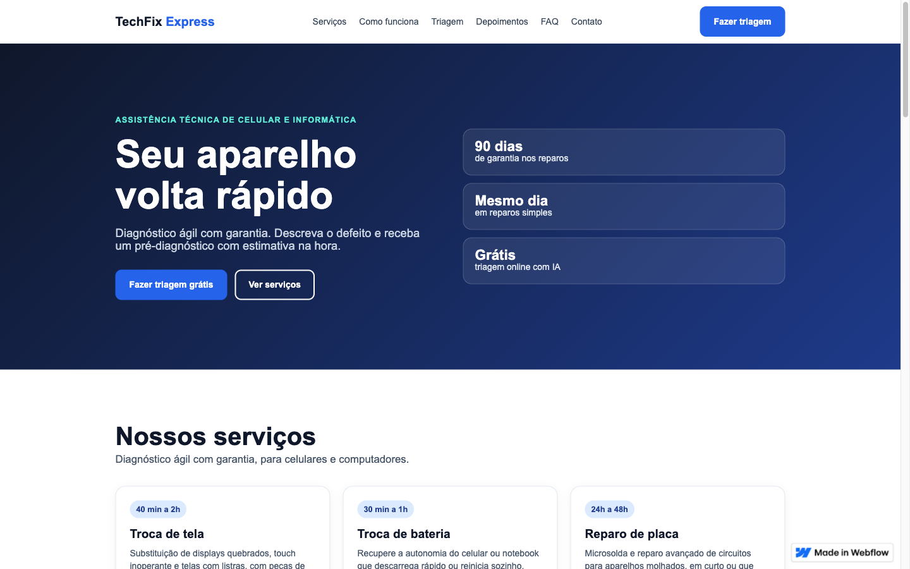
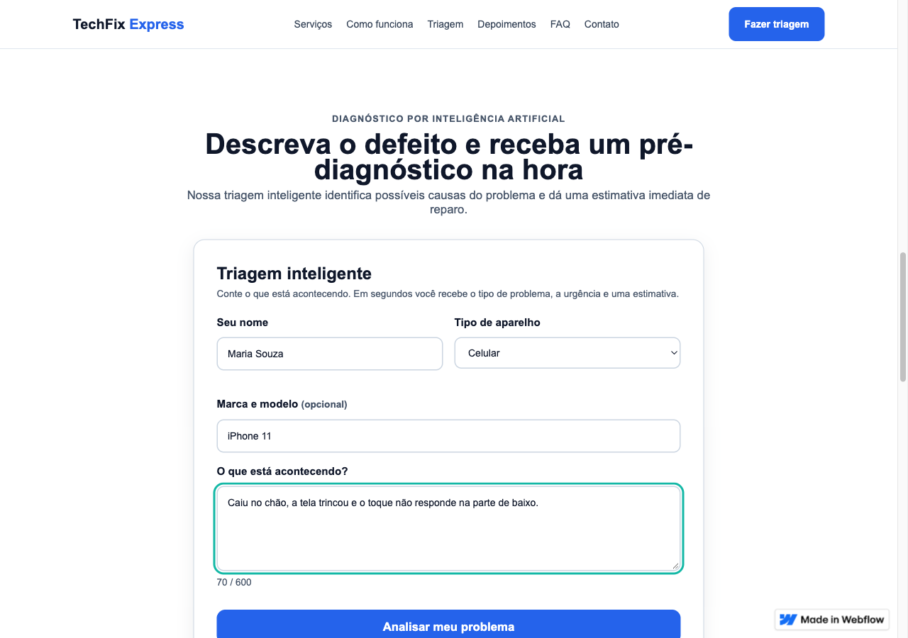
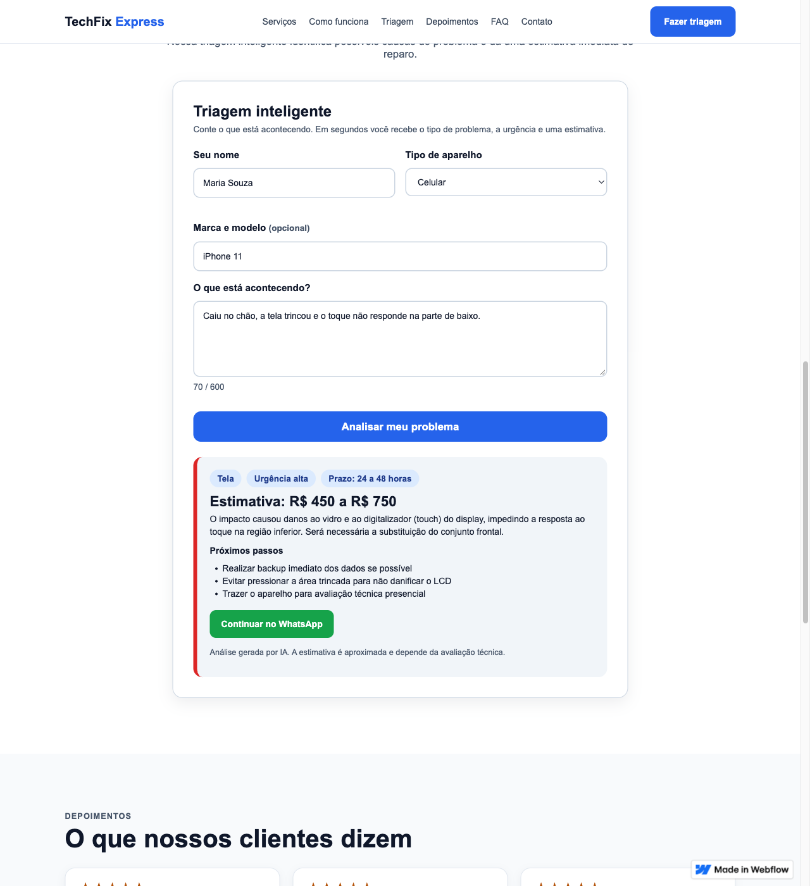
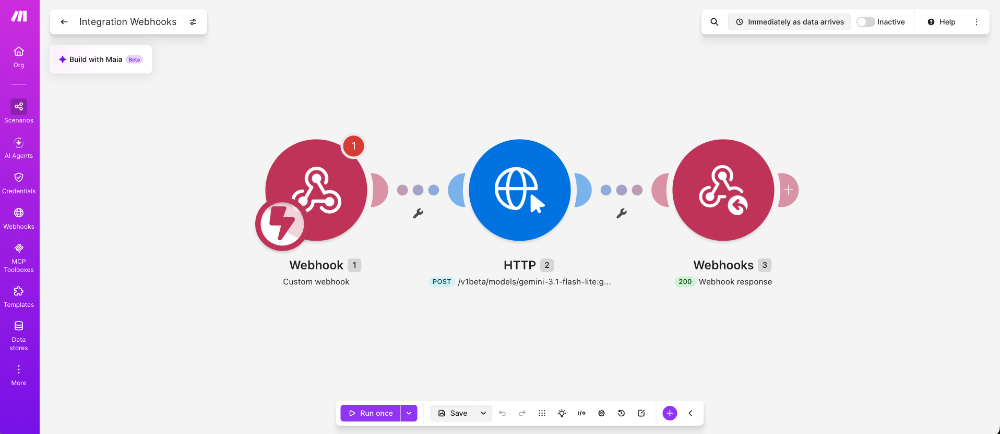
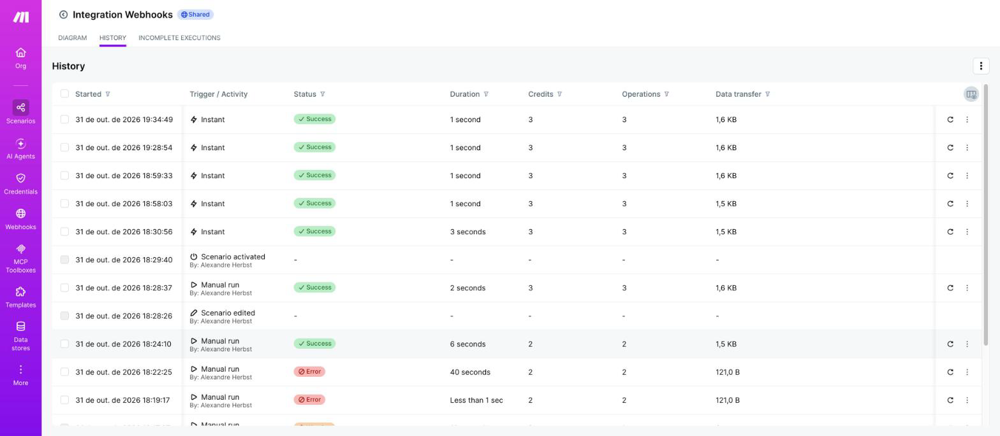

# TechFix Express — Smart Web Experience

Site de uma assistência técnica de celulares e informática (cliente **fictício**), feito em **Webflow** e personalizado com **HTML, CSS e JavaScript**, com um recurso de **IA via Make + Gemini** que faz uma triagem do defeito em segundos.

**Link público:** https://alexandres-stupendous-site-c44438.webflow.io/

**Documento teórico:** [docs/Documento-Teorico-TechFix-Express.pdf](docs/Documento-Teorico-TechFix-Express.pdf)

**Vídeo pitch:** https://drive.google.com/file/d/1IsOAXKbevd2zK4azqLZz5yuMuh-uNbyV/view?usp=sharing

> Trabalho da disciplina "Padrões Web para No Code e Low Code".

## O problema

Uma assistência técnica pequena, sem equipe de desenvolvimento, perde clientes porque quem tem um aparelho quebrado quer saber "o que pode ser?", "quanto custa?" e "quanto demora?" antes de sair de casa. Sem site, ou com um site só de vitrine, essa pessoa precisa ligar ou ir até a loja.

## A solução

Um site de página única que apresenta os serviços e tem uma **triagem inteligente**: o cliente descreve o defeito, e em poucos segundos recebe o tipo de problema, a urgência, uma faixa de preço, o prazo e os próximos passos, com um botão para continuar no WhatsApp. O diagnóstico final continua sendo feito por um técnico na bancada.

## Funcionalidades

- Navegação por âncoras entre as seções (serviços, como funciona, triagem, depoimentos, FAQ, contato), com link "pular para o conteúdo".
- Seção de serviços com 6 cards e o prazo de cada reparo.
- **Triagem inteligente**: formulário com validação, contador de caracteres e resultado gerado por IA.
- Perguntas frequentes em acordeão nativo (`
`).
- Contato direto por WhatsApp e e-mail.
- Se a IA não responder em 20 segundos, o formulário usa uma classificação simples por palavras-chave e avisa que é um resultado de demonstração. A página nunca fica sem resposta.

## Tecnologias

| Camada | O que foi usado |
|---|---|
| Plataforma no-code | Webflow (plano gratuito) |
| Personalização | HTML, CSS e JavaScript próprios (elementos HTML Embed e CSS por classes) |
| Automação | Make (cenário com webhook) |
| Inteligência artificial | Google Gemini 3.1 Flash Lite, chamado por HTTP a partir do Make |

## Personalizações com HTML, CSS e JS

- **Seções do site** escritas em HTML semântico (`header`, `nav`, `section`, `footer`, `details`) com CSS próprio, em vez de componentes prontos do template.
- **Grids responsivos** com `repeat(auto-fit, minmax(...))` e `clamp()`, sem depender de breakpoints fixos.
- **Formulário da triagem** em dois blocos HTML Embed:
  - HTML + CSS do formulário e do cartão de resultado;
  - JavaScript com validação, envio por `fetch`, tratamento de erro e renderização do resultado.
- **Envio como formulário codificado** (`URLSearchParams`), que evita o preflight de CORS no webhook.
- **Timeout de 20 s** com `AbortController` e **fallback** local.
- **Saída segura**: o texto devolvido pela IA é escapado antes de ir para a página, para evitar injeção de HTML.
- Arquivo de referência: [triagem-embed.html](triagem-embed.html), com o formulário completo (HTML, CSS e JavaScript). Neste repositório a constante `WEBHOOK_URL` está vazia, então o formulário roda em **modo demonstração** (classificação por palavras-chave); no site publicado ela aponta para o webhook do Make. No Webflow o arquivo foi dividido em dois blocos HTML Embed, por causa do limite de tamanho por bloco: o primeiro com `<style>` e o formulário, o segundo com o `<script>`.

## Recurso inteligente (IA e automação)

Fluxo no Make, com 3 módulos:

1. **Custom webhook**: recebe `nome`, `aparelho`, `modelo` e `descricao`.
2. **HTTP**: chama a API do Gemini com um prompt de sistema (triagem de assistência técnica, em português) e um `responseSchema`, que obriga a resposta a vir em JSON com `categoria`, `urgencia`, `estimativa_min`, `estimativa_max`, `prazo`, `resumo` e `proximos_passos`.
3. **Webhook response**: devolve esse JSON ao site, com `Content-Type: application/json` e CORS liberado.

A chave da API do Gemini fica **somente no Make**, nunca no código do site. Passo a passo da montagem: [MAKE-CENARIO.md](MAKE-CENARIO.md).

## Responsividade e acessibilidade

- Layout em grids que quebram de linha conforme a largura, tipografia com `clamp()` e menu que quebra para uma segunda linha em telas estreitas. O formulário passa para uma coluna em telas de até 600 px.
- Rótulos (`label`) ligados a cada campo, mensagens de erro associadas por `aria-describedby`, `aria-invalid` nos campos com erro e `aria-live` na área do resultado.
- Foco visível nos controles do formulário e nos links, e `prefers-reduced-motion` respeitado nas animações.
- Cores com bom contraste e botões grandes o bastante para toque.

## Prints

**Home no computador**

**Home no celular (390 px, sem rolagem horizontal)**

**Triagem inteligente: formulário preenchido**

**Triagem inteligente: resultado gerado pela IA, com o botão do WhatsApp**

**Cenário no Make (webhook, HTTP com o Gemini e resposta)**

**Histórico de execuções no Make (execuções com sucesso)**

## Como testar

1. Abra o link público.
2. Vá até **Triagem inteligente**.
3. Informe um nome, escolha o tipo de aparelho e descreva o problema (mínimo de 10 caracteres). Exemplo: "Caiu no chão, a tela trincou e o toque não responde na parte de baixo."
4. Clique em **Analisar meu problema**. O resultado aparece em alguns segundos, com a mensagem "Análise gerada por IA".
5. Para ver a validação, envie o formulário vazio.
6. Para ver o layout responsivo, reduza a largura da janela ou abra no celular.

## Limitações e cuidados

- A **estimativa é aproximada**: a IA não examina o aparelho, e o valor final depende da avaliação técnica.
- A URL do webhook do Make fica visível no código da página (é assim que qualquer site chama um webhook). Em produção seria preciso limitar o uso, por exemplo com um limite de requisições ou um token de curta duração.
- O plano gratuito do Make e do Gemini tem cotas. Se forem excedidas, o site cai no modo de demonstração.
- Para caber no plano gratuito do Webflow, o site foi feito em **uma página e sem CMS**. Os depoimentos e as perguntas são texto fixo.
- Cliente, depoimentos, e-mail e prazos dos serviços são **fictícios**, criados para o trabalho.

## Aprendizados

- O construtor de HTML do Webflow só aceita seletores de classe simples e ignora `@media`; por isso a responsividade foi feita com `auto-fit` e `clamp()`.
- Uma IA generativa precisa de formato de saída fixo (`responseSchema`) para integrar com um site sem quebrar.
- Modelos de IA podem ficar sobrecarregados ou indisponíveis: o timeout e o fallback tornaram o recurso confiável para quem usa.
